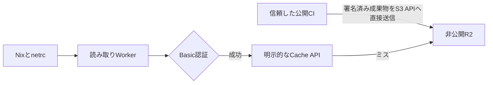

# Nix Cache

自分の端末やCIで、署名付きNixビルド成果物を非公開Cloudflare R2へ保存し、認証付きURLから再利用するためのbinary cacheです。
このREADMEはキャッシュを設置する運用者と、それを利用するNixユーザー向けです。

- **公開側**: Nixでビルドと署名を行い、R2のS3 APIへ直接アップロードします。
- **利用側**: Nixのsubstituterとnetrcを設定し、HTTP Basic認証付きWorkerから取得します。
- **管理側**: Alchemyが非公開R2バケットとWorkerを管理します。バケットの手動作成は不要です。

WorkerはEffect HTTPによる読み取り専用APIです。
UI、Worker経由のS3ゲートウェイ、WorkerでのAWS SigV4リクエスト検証は実装していません。
書き込みの認証はR2のS3 APIが担当し、読み取りの認証はWorkerが担当します。
実Cloudflareへの公開とクラウド上のpush/pullは未検証です。



## 目的に合う手順を選ぶ

- **既存キャッシュを利用する方**: Nixと読み取り資格情報、署名公開鍵があれば利用できます。Vite+やAlchemyは不要です。[端末の設定](#4-端末からキャッシュを利用する)へ進んでください。
- **キャッシュを設置する方**: [管理用の環境準備](#1-管理用の環境を用意する)、WorkerとR2の設置、成果物の公開の順に進んでください。
- **利用CIを設定する方**: [CIへの組み込み](#5-利用ciに組み込む)を参照してください。

## 1. 管理用の環境を用意する

公式[Vite+ CLI](https://vite.plus/)と、S3 binary cacheに対応したNixが必要です。
JavaScript用のNode.jsとパッケージマネージャーは、Vite+にこのプロジェクトの`package.json`から解決させます。
NixからVite+、Node.js、pnpmを追加して環境を重ねないでください。
pnpmは`packageManager`で11.21.0へ固定しています。
開発用flakeはlibraryテンプレートと同じNixツール専用shellです。
`direnv allow`または`nix develop`で読み込み、CIではhookを実行しない`nix develop .#ci`を使えます。

```bash
vp env install
vp env current
vp install --frozen-lockfile
vp run check
vp run test
vp run ci
```

別プロジェクトのセッション設定が残っている場合は、`vp env use --unset`で解除してから解決し直します。
これらのテストとビルドはCloudflareアカウントや実バケットを必要とせず、デプロイもしません。

## 2. WorkerとR2を設置する

### 資格情報を分ける

| 用途                 | 必要なもの                                 | 渡す相手                 |
| -------------------- | ------------------------------------------ | ------------------------ |
| インフラ管理         | AlchemyのCloudflare認証profile             | デプロイ担当のみ         |
| R2への書き込み       | 対象バケットに限定したR2 S3アクセスキー    | 信頼した公開CIのみ       |
| 成果物の署名         | Nix署名秘密鍵                              | 信頼した公開CIのみ       |
| Workerからの読み取り | `NIX_CACHE_USERNAME`と`NIX_CACHE_PASSWORD` | Workerと利用端末・利用CI |
| 成果物の検証         | Nix署名公開鍵                              | すべての利用者           |

R2資格情報、Nix署名鍵、HTTP読み取り資格情報は別物です。
読み取りパスワードを持つだけでは書き込みや署名はできません。
URLと署名公開鍵は共有できますが、秘密鍵、R2資格情報、netrcをflakeやGitへ入れないでください。

### 読み取りsecretを渡す

`.env.example`を資格情報の名前の参考にしてください。
このStackのAlchemy設定は、デフォルトでプロセス環境変数と任意の`.env`を読み、同じ名前ならプロセス環境変数を優先します。
`.dev.vars`はAlchemyの標準読み込み対象ではありません。
以下のどちらかで、構築時に両方の値を渡します。

- 秘密管理ツールやCIのsecret設定から`NIX_CACHE_USERNAME`と`NIX_CACHE_PASSWORD`をプロセス環境へ提供する。
- ローカルではGit除外済みの`.env`へ保存し、ファイル権限を`600`に制限する。

強い一意の値を使ってください。
ユーザー名にはコロンを使えません。
後述の共有setup-nix actionを使う場合、両方とも空白、ダブルクォート、バックスラッシュを含まない単一トークンにします。
未設定の構築時ConfigはAlchemyのエラーとなり、実行時の空の認証設定はWorkerが503で拒否します。
`src/entry.workers.ts`の`Config.Redacted`読み取りは、AlchemyによってWorkerの`secret_text` bindingへ変換されます。
別途Wranglerのsecret設定を並行管理する手順ではありません。

> [!WARNING]
> `Redacted`はログ表示の秘匿化であり、state保存時の暗号化保証ではありません。
> このStackはローカルstateを使い、AlchemyのstateエンコーダーはRedactedの内部値も保存します。
> `.alchemy/`、環境ファイル、認証profile、バックアップ、CI artifactを秘密情報として保護してください。
> 複数端末やCIから更新する前に、stateの安全な永続化・共有と更新の直列化を設計してください。

### 設置を実行する

AlchemyのCloudflare認証profileと必要な権限を用意した運用者が実行します。
計画を確認し、意図したアカウントとstageだけへ適用してください。

```bash
vp exec alchemy deploy --stage production
```

これは実クラウドを変更する操作です。
このリポジトリのテストは代わりにデプロイを実行しません。
認証や権限が不足する場合は停止し、運用者が設定を修正してください。
ローカル開発は同じ資格情報の準備後に`vp run dev`を使います。

R2とWorkerは`alchemy.run.ts`と`src/entry.workers.ts`で宣言されています。
バケットは非公開で、公開ドメインなし、強制データ破棄なしです。
Alchemyが実際に作成したバケット名とWorker URLを管理画面またはAlchemyの出力から確認し、以下の例へ反映してください。
R2バケットを別途手作業で作成しないでください。

## 3. 最初の成果物をビルド・署名・アップロードする

まずNix署名鍵ペアを作り、秘密鍵を公開CIの秘密管理へ保存します。
以下は鍵を作る端末上で、リポジトリ外の保護されたディレクトリに移動して実行する例です。
既存の鍵を上書きしない配置で実行してください。

```bash
umask 077
set -C
nix key generate-secret --key-name cache.example.com-1 > cache-signing-key.sec
nix key convert-secret-to-public < cache-signing-key.sec > cache-signing-key.pub
```

公開鍵ファイルの内容を利用者へ渡します。
秘密鍵はリポジトリ外の保護された場所へ移し、公開job以外には渡しません。
未信頼PRを、署名鍵やR2書き込み権限を持つjobで実行しないでください。

公開jobでは`NIX_SIGNING_KEY_FILE`で秘密鍵ファイルを指定し、R2用の`AWS_ACCESS_KEY_ID`と`AWS_SECRET_ACCESS_KEY`を秘密管理から供給します。
Alchemy管理の実バケット名とアカウントIDを使います。

```bash
out=$(nix build .#YOUR_PACKAGE --no-link --print-out-paths)
nix store sign --recursive --key-file "$NIX_SIGNING_KEY_FILE" "$out"
nix copy --to \
  "s3://YOUR_ALCHEMY_BUCKET_NAME?scheme=https&endpoint=ACCOUNT_ID.r2.cloudflarestorage.com&region=auto&compression=zstd" \
  "$out"
```

この例は単一の出力パスを想定しています。
複数出力はそれぞれのパスを署名・転送してください。
署名には対象store pathを操作できるNix権限が必要です。
Workerはアップロードされた成果物の署名を検証しません。
利用者側の署名検証を維持し、未署名の成果物を無条件に信頼しないでください。

## 4. 端末からキャッシュを利用する

Nix設定へURLと公開鍵を追加します。
既存の公開substituterを維持するため、`extra-`設定を使います。

```ini
extra-substituters = https://cache.example.com
extra-trusted-public-keys = cache.example.com-1:PUBLIC_KEY_BASE64
netrc-file = /absolute/protected/path/nix-cache.netrc
```

netrcにはWorkerに設定した資格情報を入れ、作成時から権限を`600`などに制限します。
URLへパスワードを埋め込まないでください。

```text
machine cache.example.com
login YOUR_USERNAME
password YOUR_PASSWORD
```

以後は通常の`nix build .#YOUR_PACKAGE`で、署名を検証してキャッシュを利用します。
対象成果物が既にローカルstoreにある場合、そのコマンドだけではHTTP取得の確認になりません。
特定のstore pathを取得する場合は次の形式を使います。

```bash
nix copy --from https://cache.example.com /nix/store/KNOWN_STORE_PATH
```

multi-user Nixでは、daemonから読める保護されたnetrcの配置と、管理者によるsubstituterの許可設定が必要です。
ユーザーの設定ファイルだけではdaemonに反映されない場合があります。
`trusted-users = *`や署名検証の無効化で回避しないでください。
flakeの`nixConfig.extra-substituters`と`extra-trusted-public-keys`には公開情報のみ置けますが、利用者の設定受け入れが必要で、依存flakeからの自動継承は期待できません。

## 5. 利用CIに組み込む

CIはテンプレートに合わせ、公開リポジトリの標準GitHub-hosted `ubuntu-latest` で `check` 1ジョブのみを実行します。
全OS・CPUのmatrix、有料のlarger runner、実Cloudflareへのデプロイは通常CIに含めません。
このアプリケーション自体のCIは、外部キャッシュの資格情報を必要としません。
利用側CIで読み取りキャッシュを有効にする場合は、以下を設定します。
書き込みや署名のjobではありません。

- Repository variables: `NIX_CACHE_URL`と`NIX_CACHE_PUBLIC_KEY`。
- Repository secrets: `NIX_CACHE_USERNAME`と`NIX_CACHE_PASSWORD`。

Nixのインストールと利用者設定の生成は、monorepoの共有`setup-nix` actionに集約しています。
このアプリケーションの`nix/`、flake、JavaScript依存関係は利用CIに不要です。
共有actionへキャッシュURL、署名公開鍵、読み取り資格情報を渡してください。
アプリケーション用dev shellは不要なので`prepare-dev-shell: false`を指定します。

```yaml
steps:
  - uses: totto2727-org/monorepo/.github/actions/setup-nix@c4f4a308d1a3f73f5d7cfc521184ab8777df3a7d
    with:
      cache-url: ${{ vars.NIX_CACHE_URL }}
      cache-public-key: ${{ vars.NIX_CACHE_PUBLIC_KEY }}
      cache-username: ${{ secrets.NIX_CACHE_USERNAME }}
      cache-password: ${{ secrets.NIX_CACHE_PASSWORD }}
      prepare-dev-shell: 'false'
  - run: nix build .#YOUR_PACKAGE
```

共有actionがNix設定と保護されたnetrcを生成するため、利用者がこのアプリケーションをcheckoutしたり、Vite+やNode.jsを準備したりする必要はありません。
このリポジトリの開発CIでは、テンプレートと同じ `setup-nix@main` と `setup-typescript@main` を使い、Vite+とアプリケーション依存関係を準備します。

> [!IMPORTANT]
> 上の利用側CIの例は、公開済みの固定commitを参照します。
> 共有actionのコミット`c4f4a308d1a3f73f5d7cfc521184ab8777df3a7d`は公開済みです。monorepo側の変更は[PR #393](https://github.com/totto2727-org/monorepo/pull/393)で確認できます。
> このCI定義を実行成功の証拠として扱わないでください。

## 運用上の制限

- **費用のハードキャップはありません。** 認証前のWorker呼び出しも課金対象になり得ます。レート制限、WAF、利用量監視は未構成です。
- 読み取り資格情報は単一の共有ペアです。端末単位の失効や複数ユーザー管理は未実装です。
- 認証はCache API検索より先に実行します。キャッシュが温まっていても未認証なら401です。
- [Alchemy Workers Cache](https://alchemy.run/cloudflare/compute/cache/)はWorker実行前に応答できる自動キャッシュです。この構成ではWorker内で毎回認証するため有効にせず、認証後に明示的なCache APIを利用します。
- Cache APIはPOPごとのキャッシュで、Tiered Cacheではありません。R2読み取り回数やWorker料金の上限を保証しません。
- クライアント応答は`Cache-Control: private, no-store`です。Cloudflare Cache Rulesなどで上書きせず、Worker内部の明示的キャッシュだけを使ってください。
- 完全な200 GETのみ保存を試みます。404と部分応答は保存しません。保存可能なサイズなどの制限はCloudflare Cache APIが判断し、保存に失敗しても元の応答をstreamします。
- TTLは`nix-cache-info`が60秒、narinfoが300秒、NARが1年です。NARは同一キーで内容を変更しない前提です。
- キーはアカウントとバケットで分離し、Hostや認証情報を含めません。Cache API障害時はR2へフォールバックし、R2取得障害は内容を漏らさず502を返します。
- GETとHEADのみ対応します。`nix-cache-info`、ルート直下の`.narinfo`、`nar/`直下の単一パスセグメントを読み取れます。ハッシュ長や圧縮拡張子、文字のブラックリストは設けず、URL parserが返すpathnameの名前空間と階層だけを確認します。`nar/%2fsecret.nar`などのpercent表現もdecodeせず、同名のR2キーとして扱います。任意の名前空間、一覧取得、クエリ付きURLは拒否します。
- 単一byte range、ETag、If-Modified-Since、If-Range、If-Match、If-Unmodified-Sinceに対応します。取得競合は再評価し、再試行でも競合すれば503です。

## テストと開発資料

`vp run test`はMiniflareの実workerd、ローカルR2、Cache APIを使い、実NixのS3 pushと認証付きHTTP pullを別のローカルbinary cacheへ往復させてNARを比較します。
誤った資格情報の拒否も検証します。
これはローカルfixtureによる検証で、WorkerにS3ゲートウェイやSigV4検証があることを意味しません。
`vp run build`はUIなしのWorker artifactを`dist/ssr/`へ生成します。
通常の`vp run test`にはビルドとコンパイル済みWorkerの検証も含まれ、Alchemy bridgeをworkerdで起動して401・404、R2取得の200とContent-Length、元オブジェクト削除後のキャッシュ取得と未認証拒否を確認します。
テスト用bindingは本番のプロビジョニングやsecret設定を検証しません。

通常CIは代表環境のLinux amd64 1件で、既存の整形・型検査・ビルド・テストを実行します。
共有セットアップactionはテンプレートと同じものを使い、`ci` shellを準備して `nix print-dev-env` で読み込みます。
Nixは実Nixを使うfixture検証のために導入し、Vite+・Node.js・pnpmはNixで提供しません。
実Cloudflareへの公開、クラウド上のpush/pull、課金特性の検証は別途必要です。
実装時の品質方針は[AGENTS.md](AGENTS.md)にまとめています。

### 参考資料

- [Nix S3 binary cache](https://nix.dev/manual/nix/2.28/store/types/s3-binary-cache-store)
- [Nix binary cache署名と信頼設定](https://nix.dev/manual/nix/2.28/command-ref/conf-file.html#conf-trusted-public-keys)
- [R2 S3 API](https://developers.cloudflare.com/r2/api/s3/api/)
- [R2をWorkersから利用](https://developers.cloudflare.com/r2/api/workers/workers-api-usage/)
- [Cloudflare Cache API](https://developers.cloudflare.com/workers/runtime-apis/cache/)
- [Alchemy](https://alchemy.run/)
