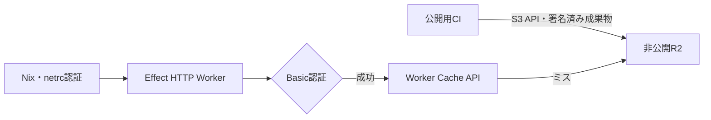

# Nix Cache

Alchemy、Vite Plus、Effect HTTPで構成する、認証付きのNix binary cache読み取りWorkerの試作です。
UIとS3互換サーバーはありません。

## 構成



R2バケットとWorkerは`alchemy.run.ts`と`src/entry.workers.ts`で管理します。
R2の公開アクセスは無効で、バケット削除時の強制データ破棄も無効です。
設定する資格情報はAlchemyの`Config.Redacted`でWorkerのsecret bindingとして扱います。
参照元の[Effront](https://github.com/totto2727-org/effront)と同じAlchemy v2のStack・Worker Layer構成ですが、ReactやEffrontのUIパッケージは不要です。

## ローカル検証

Node.js、pnpm、公式Vite Plus CLI、S3 binary cache対応のNixを用意します。
Nixの開発環境は`nix develop`でNode.jsとpnpmを提供します。

```bash
vp install --frozen-lockfile
vp check
vp test run
vp build
vp run test:build
```

`vp test run`はMiniflareの実workerd・ローカルR2・Cache APIで、本番と同じEffect HTTPハンドラーを検証します。
実Nixの`nix copy --to s3://...`でpushし、認証付きWorkerから`nix copy --from`で別のローカルbinary cacheへpullして、NARの一致を確認します。
S3書き込みとHTTP読み取りの誤った資格情報も拒否されることを確認します。
この往復検証はmacOS arm64で成功しており、実Cloudflareへのpush/pullとLinux上の実行は未検証です。
実Cloudflareでの認証や料金は不要です。
`vp build`はAlchemy Worker bridgeと依存パッケージを含むUIなしのWorker artifactを`dist/ssr/index.js`と同じディレクトリ内のチャンクへ生成します。
`vp run test:build`は実際のビルド出力をworkerdで起動し、未認証リクエストの401と、認証後の空R2バケットに対する404を確認します。
テスト専用入口は本番Alchemy設定の代わりにローカルbindingを提供するため、本番のプロビジョニングやsecret binding自体はこのテストだけでは検証されません。

Alchemy開発モードは別途Cloudflareの認証profileが必要です。
この試作の検証のために実アカウントへ自動デプロイしません。

## デプロイする場合

`.dev.vars.example`を参考に、推測困難な`NIX_CACHE_USERNAME`と`NIX_CACHE_PASSWORD`を安全な環境設定で渡します。
ユーザー名にコロンは使用できず、空の認証設定は503で拒否されます。
秘密情報をGitに追加しないでください。
Alchemy CLIのprofileを用意し、計画を確認した上で実行します。

```bash
vp exec alchemy deploy --stage production
```

Alchemyのstateはローカル保存です。
CIで継続的にインフラを更新する場合は、stateを安全に永続化・共有する設計が必要です。
本試作は単一の読み取り資格情報を使います。
端末単位の失効や複数ユーザーが必要になった時点で、複数credentialまたはAccessなどへ拡張してください。

## キャッシュの仕様と制限

- 認証はキャッシュ検索より先に必ず実行します。キャッシュが温まっても未認証アクセスは401です。
- 対象は`nix-cache-info`、32文字のNix hashを持つ`.narinfo`、`nar/`以下の52文字Nix hashを持つ`.nar`と対応する圧縮形式です。
- GETとHEADのみを許可し、その他は405です。任意キー、クエリ付きURL、一覧取得は拒否します。
- R2のバイナリbodyをstreamで返します。HEAD、単一byte range、ETag、If-Modified-Since、If-Range、If-Match、If-Unmodified-Sinceに対応します。
- HEADとGETの間に内容が変化した場合はR2のETag条件付き取得で検出し、条件を再評価します。再試行でも競合した場合は503です。
- Cache APIのキーはアカウントとバケットで分離し、クライアントのHostや認証情報を含めません。
- 完全な200 GETのみをCache APIへ保存します。404と部分応答は保存しません。
- TTLは`nix-cache-info`が60秒、narinfoが300秒、NARが1年です。NARは同一キーの内容を変更しない前提です。
- 128 MiBを超えるオブジェクトはキャッシュせずR2からstreamします。制限はプランごとの上限を保証するものではなく、控えめな試作設定です。
- クライアントへの応答は`Cache-Control: private, no-store`です。認証を通らない外側のCDNやプロキシにprivateデータを保存させないためです。
- CloudflareのCache RulesでWorker応答の`no-store`を上書きしないでください。キャッシュはWorker内部で明示的に管理します。
- Cache APIはデータセンターごとのキャッシュであり、Tiered Cacheではありません。R2読み取り回数やWorker呼び出し回数の課金上限を保証しません。
- キャッシュ障害はR2へフォールバックし、R2取得障害は内容を漏らさず502を返します。
- レート制限・WAF・利用量監視は未構成です。Basic認証だけでWorkerへのリクエスト課金まで防げるわけではありません。

## Nixクライアント設定

URLと署名公開鍵は共有できますが、秘密鍵・パスワードはflakeへ記録しません。
複数flakeで共通利用する場合は端末やCIのNix設定へ追加します。

```ini
extra-substituters = https://cache.example.com
extra-trusted-public-keys = cache.example.com-1:PUBLIC_KEY_BASE64
netrc-file = /absolute/protected/path/nix-cache.netrc
```

netrcは権限を600などに制限し、実際の資格情報で作成します。

```text
machine cache.example.com
login YOUR_USERNAME
password YOUR_PASSWORD
```

multi-user Nixではdaemonから読める保護された配置と、管理者によるsubstituter許可設定が必要です。
`trusted-users = *`や署名検証の無効化で回避しないでください。
`nixConfig.extra-substituters`と`extra-trusted-public-keys`をflakeへ置くこともできますが、設定の受け入れが必要で、依存flakeからの自動継承は期待しないでください。

## アップロード

書き込みはWorkerを経由せず、公開CIからR2のS3 APIへ送信します。
R2アクセスキーとNix署名鍵は別の資格情報です。
次の例は署名鍵ファイルとR2用AWS環境変数を安全に提供している前提です。

```bash
out=$(nix build .#YOUR_PACKAGE --no-link --print-out-paths)
nix store sign --recursive --key-file "$NIX_SIGNING_KEY_FILE" "$out"
nix copy --to \
  "s3://YOUR_ALCHEMY_BUCKET_NAME?scheme=https&endpoint=ACCOUNT_ID.r2.cloudflarestorage.com&region=auto&compression=zstd" \
  "$out"
```

実際にAlchemyが作成したバケット名を使います。
バケットを手作業で別途作成しないでください。
公開CI以外には書き込み権限と署名秘密鍵を渡さず、未信頼PRを署名用jobで実行しないでください。

## 共有ツールの3環境検証

[検証構成・実行方法・実測範囲](docs/nix-validation.md)を参照してください。
`nix/`はmonorepoの共有パッケージを固定した試験入力で、Linux arm64、Linux amd64、macOS arm64のネイティブCIを定義します。
Linuxのderivation評価はLinux上での実行成功を意味しません。

## 参考資料

- [Nix S3 binary cache](https://nix.dev/manual/nix/2.28/store/types/s3-binary-cache-store)
- [R2をWorkersから利用](https://developers.cloudflare.com/r2/api/workers/workers-api-usage/)
- [Cloudflare Cache API](https://developers.cloudflare.com/workers/runtime-apis/cache/)
- [Alchemy](https://alchemy.run/)
